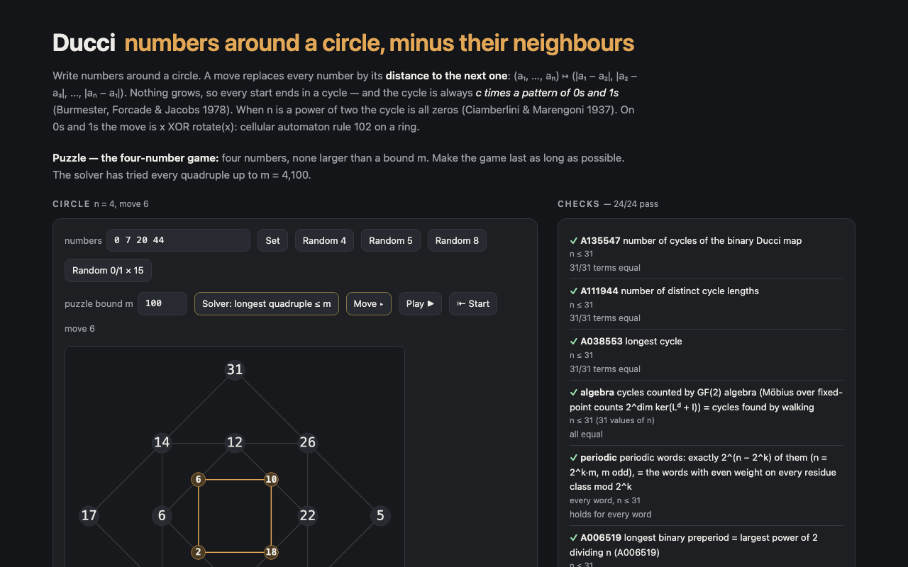

# Ducci

Write numbers around a circle. A move replaces every number by its **distance to the next one**:

    (a₁, a₂, …, aₙ) ↦ (|a₁ − a₂|, |a₂ − a₃|, …, |aₙ − a₁|)

The largest number never grows, so every start ends in a cycle. Burmester, Forcade & Jacobs (1978) showed the cycle
is always **c × (a word of 0s and 1s)**; when n is a power of two it is all zeros (Ciamberlini & Marengoni 1937). On
0s and 1s, |x − y| = x XOR y, so the move is the linear map x ↦ x XOR rotate(x) over GF(2): elementary cellular
automaton rule 102 on a ring.

This repo puts the map in the browser with a solver and checks the published results by exhaustive computation:

- **play** any tuple, drawn as nested polygons (each new tuple sits on the edge midpoints of the previous one), with
  its preperiod, period and the cycle written as c × word;
- **puzzle, the four-number game**: four numbers, none above a bound m; make the game last as long as possible. The
  solver has tried every quadruple up to m = 4,100 and knows the record for each m;
- **rule 102**: the space-time picture of a 0/1 word, with the cycle marked;
- every **0/1 word of every length n ≤ 31** (4,294,967,294 words) and **every quadruple with entries ≤ 4,100**
  (34,494,130,251 up to symmetry) walked, plus all n-tuples with small entries for n = 3, 5, 6, 7, 8, 9.



## What is in it

| file | |
|---|---|
| `src/ducci.ts` | the move, orbits, Brent's cycle detection, the fast quadruple length, the binary map on bit words, the periodic-word test, GF(2) matrices and the Möbius cycle count |
| `src/main.ts` | the demo page |
| `tools/binary.mts` | every n-bit word for n ≤ 31, walked once each → `runs/binary.json` |
| `tools/integer.mts` | the four-number game up to 4,100 and the n-tuple census → `runs/integer.json` |
| `tools/verify.mts` | the checks below → `runs/verify.json`, and `runs/page.json` (the slice the page reads) |
| `ref/` | OEIS b-files (CC BY-SA 4.0) |
| `tests/` | 10 vitest tests |

The page reads `runs/*.json`; no number on it is typed by hand.

## Setup

```sh
npm install
npm test                          # 10 tests
node tools/binary.mts 31          # ≈ 6 min, 2 × 256 MB of bitsets at n = 31
node tools/integer.mts 4100       # ≈ 16 min (quadruples 9.5 min, n-tuples 6.5 min)
node tools/verify.mts             # < 1 s
npm run dev                       # http://localhost:5173/portfolio/ducci/
npm run build
```

Node 22.6+ (runs `.mts` with type stripping). No runtime dependencies.

## How the censuses work

**Binary.** A word is an n-bit integer; a move is `x ^ rotr(x, 1)`. Two bitsets of 2ⁿ bits: *seen* and *on a cycle*.
From every unseen word, walk until a seen word; if that word is on the current walk, a new cycle has closed — go round
it once, marking it. Every word is stepped once. A second pass walks each word to its cycle for the preperiod
histogram and checks the periodic-word criterion on every word. Then the cycles are counted a second time without
walking: words with Dᵈx = x number 2^dim ker(Lᵈ + I) (L the n × n GF(2) matrix), Möbius inversion gives the words of
exact period d, and the cycles are Σ g(d)/d.

**Quadruples.** The length is unchanged by rotation, reflection and adding a constant, so only (0, b, c, d) with b ≤ d
is tried: (M + 1)³ / 2 quadruples for bound M, each played to 0000 in registers. The record length for each exact
maximum m gives the longest game for every bound at once.

**Other n.** Every n-tuple with entries ≤ Mₙ and a 0 in front, followed with Brent's algorithm (no orbit stored).

## Results

| check | range | result |
|---|---|---|
| OEIS A135547, number of cycles of the binary map | n ≤ 31 | all 31 terms equal (n = 31: 34,636,834) |
| OEIS A111944, number of distinct cycle lengths | n ≤ 31 | all equal |
| OEIS A038553, longest cycle | n ≤ 31 | all equal (n = 29: 475,107) |
| the same cycles counted by GF(2) algebra | n ≤ 31 | equal for every n |
| periodic words: exactly 2^(n − 2ᵏ) for n = 2ᵏm, m odd; = words with even weight on every residue class mod 2ᵏ | every word, n ≤ 31 | ✓ |
| longest binary preperiod = 2ᵏ, the largest power of 2 dividing n (A006519) | n ≤ 31 | ✓ |
| A138004 (odd n whose nontrivial cycles all have one length) ⇔ exactly 2 cycle lengths | odd n ≤ 31 | ✓ |
| OEIS A065677, longest four-number game with entries ≤ m | m ≤ 72 (b-file) | all 73 equal; **extended to m = 4,100** |
| OEIS A065678 and A045794 (least bound for each length) | lengths ≤ 23 | all equal; the next term, 4,841, is past the census |
| Barker's recurrence a(L) = 3a(L−3) + a(L−6) + a(L−9) on the A065678 b-file | L = 11 … 1000 | ✓ (at L = 10 it would give 14, the term is 13) |
| Burmester–Forcade–Jacobs: every cycle is c × (0/1 word), as long as that word's binary cycle | n = 3, 5, 6, 7, 8, 9 | ✓ for all 67 million tuples |
| Ciamberlini–Marengoni: n = 8 always reaches 0 | entries ≤ 9 | ✓ |

Things the census shows that I did not find written down:

- **The longest quadruple is unique.** For every record length from 7 to 23, exactly two normal forms attain it:
  a quadruple q and its mirror m − q. So the slowest game for a bound is unique up to rotation, reflection, adding a
  constant and x ↦ m − x. The records are 0 1 4 9, 0 2 5 11, 0 2 6 13, 0 5 14 31, …, 0 653 1854 4063.
- **Three more moves cost a factor q² ≈ 3.383 in the bound**, q the tribonacci constant: the recurrence's
  characteristic polynomial in y = x³ is y³ − 3y² − y − 1, and q² is its root.
- **For n = 3, 5, 9 the longest preperiod with entries ≤ m is (n − 2)(m − 1) + 1**: m for triples (by 0 m 1), 3m − 2
  for n = 5 (by 0 m m−1 0 0), 7m − 6 for n = 9. Checked for m ≤ 3000, 55 and 7.
- For n = 6, 7, 8 the same record is irregular: 0, 2, 5, 8, 11, 13, 15, 16, 17, 19, 21, … (n = 6, then 2m + 1 from
  m = 8), 0, 1, 6, 11, 13, 17, 20, 22, 25, 28, 32, 35, 39, 42, 46 (n = 7), 0, 8, 8, 14, 15, 15, 15, 18, 21, 21 (n = 8).
  None of these is in OEIS.

## License

MIT. The files in `ref/` are OEIS data, CC BY-SA 4.0.

<!-- sen-publish:links -->
## Links

- 🌐 Demo: https://sen.ltd/portfolio/ducci/
- 📝 記事: https://qiita.com/sen-ltd/items/0fd9d746add6affe8aee
<!-- /sen-publish:links -->
